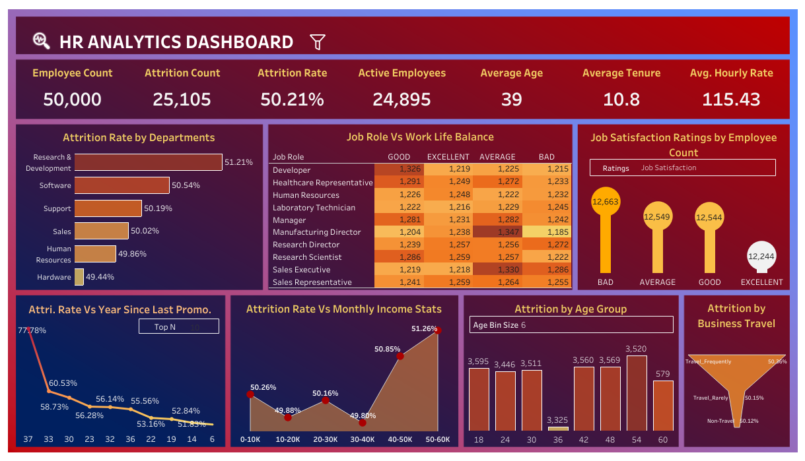

# 👥 HR Analytics Dashboard - Tableau

## 📌 Overview

This Tableau HR Analytics Dashboard provides a comprehensive view of employee attrition, workforce demographics, job satisfaction, work-life balance, and compensation trends. It is designed to support HR managers, business leaders, and analysts in monitoring KPIs, understanding why employees leave, and improving retention strategies.

---

## ✨ Key Features

* Summary cards displaying employee count, attrition count, attrition rate, active employees, average age, average tenure, and average hourly rate.
* Department-wise attrition analysis.
* Job role vs. work-life balance heatmap.
* Job satisfaction ratings by employee count.
* Attrition analysis by years since last promotion, monthly income, age group, and business travel.
* Interactive parameters for Top N, Ratings, and Age Bin Size.

---

## 📊 KPIs & Metrics Used

* **Employee Count**: 50,000
* **Attrition Count**: 25,105
* **Attrition Rate**: 50.21%
* **Active Employees**: 24,895
* **Average Age**: 39 years
* **Average Tenure**: 10.8 years
* **Avg. Hourly Rate**: 115.43

---

## 🖼️ Dashboard Snapshot

*Interactive Tableau dashboard showcasing key HR KPIs and employee attrition insights.*

---

## 📉 Visuals & What They Show

* **Attrition Rate by Departments**: Attrition comparison across departments (Research & Development 51.21%, Software 50.54%, Support 50.19%, Sales 50.02%, Human Resources 49.86%, Hardware 49.44%).
* **Job Role Vs Work Life Balance**: Heatmap showing employee counts for Good, Excellent, Average, and Bad work-life balance across 10 job roles (Developer, Healthcare Representative, Human Resources, Laboratory Technician, Manager, Manufacturing Director, Research Director, Research Scientist, Sales Executive, Sales Representative).
* **Job Satisfaction Ratings by Employee Count**: Bad (12,663), Average (12,549), Good (12,544), Excellent (12,244).
* **Attrition Rate Vs Year Since Last Promotion**: Line chart showing how attrition changes with years since last promotion, with a Top N filter (highest value 77.78% at 37 years).
* **Attrition Rate Vs Monthly Income Stats**: Area chart of attrition across income bands (0–10K: 50.26%, 10–20K: 49.88%, 20–30K: 50.16%, 30–40K: 49.80%, 40–50K: 50.85%, 50–60K: 51.26%).
* **Attrition by Age Group**: Bar chart of employees who left by age bin (adjustable bin size): 18 (3,595), 24 (3,446), 30 (3,511), 36 (3,325), 42 (3,560), 48 (3,569), 54 (3,520), 60 (579).
* **Attrition by Business Travel**: Funnel chart showing attrition by travel frequency (Travel_Frequently 50.36%, Travel_Rarely 50.15%, Non-Travel 50.12%).

---

## 🔑 Key Insights

* Overall attrition is **50.21%** (25,105 employees left), which is very high and needs immediate attention.
* **Research & Development** has the highest department attrition (**51.21%**), while **Hardware** has the lowest (**49.44%**).
* Employees with **50–60K** monthly income show the highest attrition (**51.26%**), suggesting pay alone does not drive retention.
* Attrition is highest among employees with a **long gap since last promotion** (up to **77.78%**), highlighting the need for career growth programs.
* **Frequent business travelers** have the highest attrition (**50.36%**) compared to non-travelers (**50.12%**).
* **Manufacturing Director** and **Sales Executive** roles report the most "Average" work-life balance ratings (**1,347** and **1,330**).
* Job satisfaction counts are spread almost evenly across all four rating levels.

---

## 🛠️ Tools & Technology Used

* **Tableau Desktop** – Dashboard creation and visualization.
* **Excel/CSV Dataset** – Data source.

---

## 📂 Data Fields Used

* Employee ID, Age, Gender, Department, Job Role
* Attrition (Yes/No), Business Travel
* Monthly Income, Hourly Rate
* Years Since Last Promotion, Years at Company (Tenure)
* Job Satisfaction, Work Life Balance

---

## 🎛️ Interactivity & Design

* **Parameters**: Top N (years since last promotion), Ratings (job satisfaction), Age Bin Size (age group).
* **Dynamic Visuals**: Charts update instantly based on parameter selections.
* **Heatmap Highlighting**: Color intensity shows high and low employee counts across job roles.
* **User-friendly Layout**: Clear KPI cards, charts, and a funnel for quick insights.

---

## 🏷️ Tags

`#HR Analytics` `#Attrition Analysis` `#Data Analytics` `#Tableau Desktop` `#Dashboard` `#Data Visualization`

---

## 🎯 Click Below to Explore the Dashboard  

  
  <a href="https://public.tableau.com/app/profile/syed.yaseen1131/viz/HRAnalytics_17931963570730/Dashboard1" target="_blank">
    🚀 Launch Live Dashboard
  </a>

##  Author

**Syed Yaseen**  
*Aspiring Data Analyst | Power BI | Excel | SQL | Tableau*

⭐ **Don't forget to star the repo if you found it helpful!**
